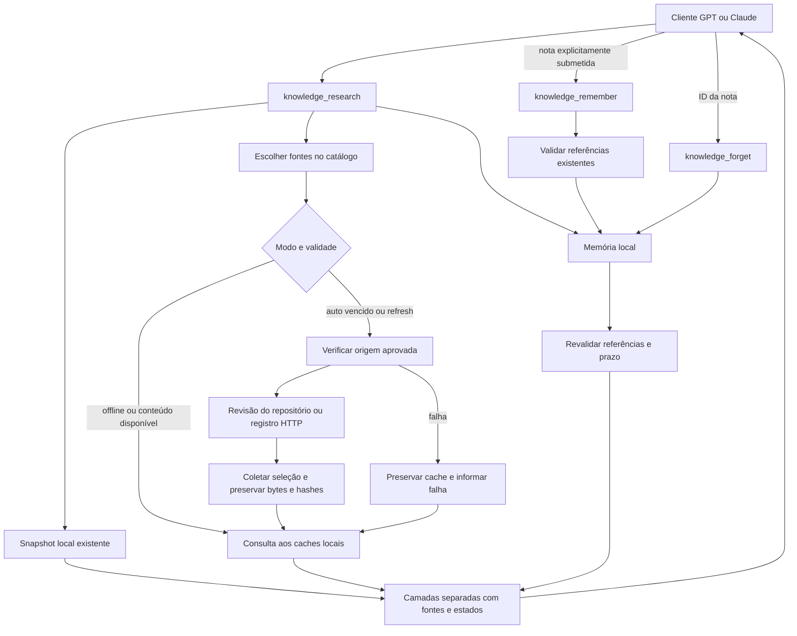

# Pesquisa sob demanda e memória derivada

Revisão de 21/10/2026. A pesquisa reúne o snapshot existente, caches locais de fontes consultadas por URLs cadastradas e memória derivada. O catálogo em execução informa as fontes disponíveis e suas restrições. A coleta não transforma repositórios remotos em um índice semântico completo nem treina o modelo conectado. O [histórico de implementação](IMPLEMENTACAO.md) distingue as etapas e os ensaios já registrados.

## Fluxo implementado



O snapshot conserva SQLite, entidades, relações, originais, E5 e Qdrant já preparados. O cache OWASP original usa `data/ondemand/cache.sqlite3`; os novos adaptadores usam bancos separados em `data/ondemand/sources/<source_id>.sqlite3`, com versões e FTS5. As notas usam `data/memory/memory.sqlite3`, também com FTS5. Os armazenamentos pertencem ao mesmo diretório de dados e podem ser usados por ambos os clientes.

`knowledge_research` retorna `layers.snapshot`, `layers.source_cache` e `layers.memory`. Escores das camadas não são comparáveis. O serviço reduz duplicatas identificáveis, mas um arquivo agregado no cache e um objeto extraído no snapshot podem ter IDs distintos: preservam-se as identidades e referências reais, sem inventar equivalências. Uma nota derivada nunca conta como confirmação independente da sua fonte.

`knowledge_search`, `knowledge_get_entity`, `knowledge_get_document` e `knowledge_get_related` continuam consultando somente snapshots. Baixar evidências sob demanda não adiciona vetores E5 nem altera a geração ativa. O snapshot inicial desta máquina permanece com 1.774 documentos e perfil `semantic`; essas contagens não incluem o cache ou a memória. `knowledge_status` descreve o snapshot e informa capacidades remotas separadamente; `knowledge_catalog` detalha os caches.

## Catálogo e descoberta

`knowledge_catalog` apresenta as fontes registradas com IDs, assuntos, URLs de entrada, formato, branch quando aplicável, exemplos de consulta, política de validade e capacidade de pesquisa. A lista é construída a partir da configuração do código; acrescentar uma URL arbitrária à pergunta não cadastra uma fonte. O modo `on_demand_and_snapshot` identifica as fontes do piloto que também têm acesso remoto; `on_demand_and_local_cache` identifica fontes cujo conteúdo coletado fica no cache separado. Confira `access_note` e `query_requirement` antes da consulta.

A configuração desta entrega reúne 38 fontes, incluindo o adaptador OWASP original. A [tabela de fontes](FONTES.md) registra cada ID, escopo, exemplo e origem. Esse total é de conectores configurados, não de fontes disponíveis agora, arquivos coletados ou documentos do snapshot.

| Tipo de fonte | Descoberta e recuperação |
| --- | --- |
| Repositório com arquivos individuais, como OWASP e Sigma | Resolve a revisão, lista caminhos permitidos e seleciona arquivos por nome, identificadores e aliases locais. O corpo só fica pesquisável depois da coleta. |
| Arquivos agregados, como ATT&CK e KEV | Recupera o arquivo registrado e extrai texto estruturado para pesquisa local, preservando o original completo. Um bundle pode conter muitos registros mesmo quando conta como um arquivo do cache. |
| CVE no GitHub | Exige um CVE e deriva seu caminho no repositório oficial; não baixa toda a lista de CVEs. |
| NVD, CWE, eventos Windows, CIS Controls e MalAPI | Exige o identificador previsto no catálogo e consulta o endpoint oficial daquele registro. Revisão e verificação são individuais. Um endpoint cadastrado pode estar indisponível. |
| Outras URLs HTTP cadastradas | Preserva uma cópia local com hash e a URL de origem; consulta somente o recurso aprovado. |

A pergunta completa não é enviada como busca textual aos repositórios. Consultas por identificador enviam à API o CVE, CWE ou evento escolhido; downloads também revelam à origem o caminho solicitado. Não existe um LLM interno para escolher, resumir ou validar fatos. O roteamento automático usa IDs e assuntos do catálogo; fontes explícitas deixam a seleção mais previsível.

A descoberta por nome pode deixar de encontrar um assunto presente apenas dentro de um arquivo ainda não coletado. `known_paths` mede caminhos conhecidos; `cached_versions` mede versões preservadas. Nenhum dos dois representa indexação completa do repositório, número de entidades ou cobertura semântica. Consultas sem filtro em `offline` percorrem somente caches já existentes.

O parâmetro `path` exige uma única fonte explícita e um caminho permitido, como `cheatsheets/Password_Storage_Cheat_Sheet.md` na fonte `owasp`. Não aceita URL, saída do diretório, branch escolhida pelo cliente ou arquivo local. Árvores recursivas do GitHub marcadas como `truncated` são recusadas; uma listagem incompleta não é anunciada como catálogo íntegro. O adaptador OWASP original também recusa a listagem de mil entradas que pode indicar o limite da API de conteúdos.

A fonte chamada “EventKB” ainda não foi identificada com segurança. `windows-events` é uma alternativa explícita baseada na documentação oficial da Microsoft, e não uma implementação ou renomeação do EventKB. Normas, artigos e conjuntos sujeitos a acesso ou licenciamento aparecem com restrições específicas no catálogo. A presença de outra fonte na mesma área não substitui esses materiais.

Escopos específicos verificados em 21/10/2026:

| Fonte | Cobertura e restrições |
| --- | --- |
| `malapi` | Conector por nome exato de API, como `VirtualAlloc`, para a origem oficial. O domínio apresentou falha de DNS na verificação e forneceu zero evidências. O cadastro não significa disponibilidade; nenhuma fonte alternativa é atribuída silenciosamente ao MalAPI. |
| `unprotect` | 376 caminhos de descrições principais em `Techniques/*/description.txt` no [repositório oficial de contribuições](https://github.com/Unprotect-Project/ContributeV2). Não representa todo o site: snippets, código, regras, binários e metadados auxiliares ficam fora. Não foi confirmada licença aberta geral; consulte os [termos do projeto](https://unprotect.it/page/terms-and-conditions/) e as permissões do conteúdo. |
| `capa` | 1.055 caminhos de regras textuais dos diretórios selecionados em [Mandiant CAPA Rules](https://github.com/mandiant/capa-rules), incluindo regras experimentais identificadas por `nursery/`. A coleta não compila nem executa regras e não valida sua eficácia de detecção. |
| `vx-papers` | Lista explícita de 15 artigos do [VXUG-Papers](https://github.com/vxunderground/VXUG-Papers): 14 PDFs e um TXT. Implementações, binários e demais conteúdos do repositório ficam fora. Não houve confirmação de licença geral de redistribuição; os direitos variam por artigo e o cache local não autoriza publicar o corpus. |

As contagens acima descrevem a seleção ou a descoberta naquela revisão, não arquivos já baixados nem garantia de que cada documento pode ser extraído. O catálogo em execução informa os caminhos e avisos atuais.

As fontes de governança mantêm limites distintos. `nist-csf` e `nist-800-53` usam catálogos OSCAL oficiais. `cis-controls` consulta as páginas públicas da especificação de avaliação CAS v8, por `Control 1` a `Control 18`, sob os termos CC BY-NC-ND 4.0. `lgpd` usa o texto atualizado da Câmara dos Deputados, identificada como alternativa oficial ao endpoint Planalto indisponível. `gdpr` usa duas publicações fixas em inglês no Cellar: original de 2016 e consolidada com corrigendum de 2018; não descobre automaticamente alterações jurídicas posteriores.

`iso27001` seleciona apenas metadados abertos de edições e suplementos no CSV oficial ISO, sob ODC-By 1.0 com atribuição. O arquivo completo, aproximadamente 60 MB e limitado a 96 MiB, é preservado para integridade, mas somente os registros selecionados entram no texto pesquisável. O transporte usa `HEAD` e até oito faixas paralelas com ETag forte, `If-Match`, `Content-Range` e tamanho conferidos; só entrega o original completo. O adaptador admite até 90 segundos por operação, respeitando o prazo restante da pesquisa, também limitado a 90 segundos; não troca automaticamente para outro formato. **Não inclui texto normativo nem requisitos da ISO 27001.** As URLs, edições e condições estão em [Fontes](FONTES.md#fontes-de-governança-normas-e-legislação); essas fontes não comprovam conformidade de uma organização.

## Verificação e funcionamento sem rede

| Modo | Comportamento |
| --- | --- |
| `auto` | Reutiliza a verificação dentro do TTL da fonte; consulta a origem quando a política exige. Pode coletar um arquivo ausente na revisão conhecida. Atualmente CVE/NVD/KEV usam uma hora; a maioria das demais fontes usa 24 horas. Confira o catálogo. |
| `refresh` | Solicita nova verificação da fonte ou registro, respeitando o intervalo de nova tentativa após falha. Não garante sucesso da rede. |
| `offline` | Não acessa a rede. Busca somente no snapshot, cache já existente e notas elegíveis. |

A verificação usa requisições condicionais quando suportadas pelo adaptador e pela origem. Um `304` exige metadados locais compatíveis; não cria conteúdo ausente. As fontes cadastradas são públicas e não exigem que o cliente entregue um token. A NVD tem intervalo local entre consultas; limites do provedor podem continuar causando espera ou falha.

Cada evidência informa revisão, SHA-256, URL de origem, referência de licença e `checked_at`. Repositórios GitHub/GitLab usam referências fixadas em commit. Uma URL HTTP pública pode mudar: o hash fixa os bytes locais, não torna imutável o endereço remoto. O `original_hash` sempre descreve os bytes preservados. Na NVD, a revisão do registro é calculada sobre seu conteúdo, excluindo o timestamp variável do envelope; os bytes originais da resposta continuam preservados. Conferir um CVE, CWE, evento ou controle CIS não renova a data dos outros registros.

Os estados do cache são `current`, `stale`, `superseded` e `unknown`. `current` significa compatível com a última revisão verificada dentro da política de validade; não significa que houve acesso à origem nesta chamada nem que o conteúdo está factualmente correto.

Mudanças na configuração do adaptador são detectadas por uma impressão digital da configuração. Enquanto o catálogo e a evidência não forem compatíveis com a nova configuração, o estado é `unknown`, com indicação `source_configuration_changed` quando aplicável. A nova coleta pode reconstruir o texto pesquisável e a atribuição da mesma revisão, preservando a identidade, os bytes e o hash do original. Se esses bytes mudarem sob a mesma revisão imutável, a operação falha com `CACHE_INTEGRITY`. Não é necessário apagar o banco para atualizar essa representação.

Falhas de rede, respostas inválidas e limites de API não renovam a verificação. O servidor preserva os bytes anteriores e informa estados por fonte em `layers.source_cache.sources`, além de falhas e intervalos de tentativa no catálogo. O estado agregado `federated` não significa que todas as origens responderam. Falha em uma fonte não apaga resultados das outras; falhas por registro também são isoladas quando o adaptador trabalha por ID. Respeite `retry_at` e não repita chamadas em loop.

Se uma revisão nova for observada, a anterior deixa de sustentar uma afirmação de atualidade, mesmo que a listagem ou a coleta seguinte falhe. Uma mudança de commit pode invalidar conservadoramente uma referência mesmo quando o arquivo não mudou. Nas APIs por ID, a mudança fica restrita ao registro correspondente. A nova evidência precisa ser coletada/verificada antes de sustentar outra nota. Indisponibilidade de um banco não prova que o documento citado desapareceu.

Ao comparar cache e snapshot para validar uma nota, o serviço considera as datas locais de verificação. Uma observação de cache anterior à verificação do snapshot não invalida esse snapshot mais recente apenas por conter outra revisão. Hashes de commit não são ordenados como datas. Datas ausentes, inválidas ou no futuro e falhas relevantes levam a `unknown`, em vez de inventar uma ordem ou invalidar permanentemente uma nota.

## Extração de texto de PDF

Os PDFs permitidos usam `pypdf` 6.21.2 em um processo Python separado, iniciado em modo isolado `-I`. Antes de carregar o parser, o processo aplica teto de memória de 512 MiB: Job Object no Windows ou `RLIMIT_AS` em sistemas POSIX. O prazo é de até dez segundos, reduzido pelo prazo restante da pesquisa; ao expirar, o processo é encerrado. São limites de processo e recursos, **não uma sandbox de segurança** nem isolamento de arquivos ou rede no sistema operacional.

O parser exige assinatura PDF, aceita até 16 MiB de entrada e 100 páginas e limita o texto derivado a 2 MiB. Streams têm limite individual de 8 MiB e orçamento compartilhado de 32 MiB para bytes efetivamente decodificados, incluindo Forms, fontes e estruturas usadas pelo parser. Também há limites de filtros, operações e recursão. Falhas de limite e avisos que possam indicar conteúdo omitido são rejeitados; não se retorna silenciosamente um texto parcial após falha em um Form interno.

PDFs criptografados, mesmo com senha vazia, e documentos sem texto pesquisável são recusados. Não há OCR: páginas digitalizadas podem não contribuir texto, e uma camada OCR já existente pode conter erros. Não são solicitados renderização, execução de JavaScript, extração de anexos, abertura de links ou execução de código. O texto pode perder tabelas, colunas e ordem de leitura. Os metadados registram `representation: derived_pdf_text`, páginas com e sem texto e o aviso de extração. Esses avisos continuam relevantes quando a extração termina com sucesso.

O SHA-256 e a leitura paginada do cache continuam descrevendo o PDF original, preservado integralmente. Trechos pesquisáveis vêm da representação derivada e não substituem esse original. O estado `partial` de uma resposta paginada indica que restam partes do original; não deve ser interpretado como comprovação de OCR ou de cobertura visual completa do PDF.

## Recursos e segurança

- Somente endpoints e caminhos gerados pelos adaptadores cadastrados são aceitos. A coleta não segue links dos documentos, URLs livres ou redirecionamentos. Não executa arquivos nem utiliza credenciais do cliente.
- Cada chamada aceita até três fontes online ou até 64 filtros offline. A pesquisa e a verificação de referências compartilham orçamento de 90 segundos. Os novos adaptadores têm até 30 segundos por operação por padrão; ISO usa até 90 segundos para o CSV maior, sempre respeitando o prazo restante compartilhado. O adaptador OWASP original tem orçamento de 20 segundos. São tetos de operação, não tempos esperados: a coleta inicial ISO observada em 21/10/2026 levou 54,89 segundos naquela conexão, sem garantia para outras execuções.
- Limites de resposta variam conforme o formato da fonte; bundles agregados precisam de mais espaço que um Markdown. Novos caches têm até 1.000 versões, quota de originais de 128 ou 256 MiB conforme o adaptador e teto físico de 512 MiB por SQLite. O cache OWASP original mantém quota e teto físico de 128 MiB. Índices e metadados também ocupam disco.
- O limite global de 4 GiB conta arquivos SQLite, páginas livres e journals dos caches. Ele é conferido **antes** de cada fonte, não reserva antecipadamente os bytes: uma operação de fonte pode ultrapassá-lo. As seguintes passam a consultar apenas dados locais, com aviso. O limite não inclui snapshots, modelos ou memória derivada.
- Versões antigas permanecem acessíveis por ID e revisão. Ao atingir a capacidade, novas coletas são recusadas; não existe coleta automática de lixo do cache nesta etapa. Não apague o banco para liberar espaço se precisar preservar as referências das notas.
- Pesquisa aceita pergunta de até 4.000 caracteres e `limit` de 1 a 3 por camada, compartilhando 24.000 caracteres de evidências entre as três camadas. O limite não garante um resultado de cada fonte: consulte fontes separadamente quando necessário. A memória examina no máximo 50 candidatos lexicais por busca; verificações de referências também têm limites e podem omitir notas quando não couberem.
- A coleta remota tem trava própria. Esperar a rede não ocupa a trava do snapshot; outra operação dessa extensão pode receber `BUSY`. A etapa local da pesquisa ainda compartilha a inferência com as consultas tradicionais.

Fontes e notas são sempre dados não confiáveis. Nenhum conteúdo é executado como shell, SQL, código ou instrução de sistema. As anotações MCP descrevem os efeitos das operações, mas as verificações de entrada e as permissões são aplicadas pelo código. Isso reduz a superfície de abuso sem comprovar resistência completa a prompt injection no cliente conectado.

## Memória explícita e verificável

`knowledge_remember` recebe `text`, `references` e `ttl_days`. Cada referência deve ser copiada de `evidence_reference` retornado pela pesquisa ou leitura do cache:

```json
{
  "store": "cache",
  "document_id": "ID retornado pela ferramenta",
  "revision": "revisão retornada pela ferramenta",
  "original_hash": "SHA256 retornado pela ferramenta"
}
```

Referências com `store: "snapshot"` também exigem `snapshot_id`. Os valores acima são descritivos; não são uma referência válida para executar. Não forneça URLs ou citações livres: o servidor resolve a referência existente, confere os bytes e verifica sua atualidade.

| Regra | Implementação |
| --- | --- |
| Texto | Até 4.000 caracteres; retorno na busca limitado a 1.200 caracteres, com indicação de truncamento. |
| Evidências | De 1 a 8 referências; todas precisam estar verificáveis e atuais para gravação. |
| Confiança | Sempre `derived_unverified`. Referência existente não prova que a conclusão decorre dela. |
| Validade | De 1 a 90 dias; padrão 30. Duplicata exata não prorroga o prazo. |
| Capacidade | Até 1.000 notas e 8 MiB de texto UTF-8. |
| Busca | Lexical, separada das fontes. Filtro de fontes exige que todas as citações da nota pertençam às fontes selecionadas. |
| Mudança de evidência | Referência substituída ou ausente invalida a nota; indisponibilidade ou desatualização temporária suprime seu retorno. |
| Expiração | Pesquisa, gravação e exclusão removem notas expiradas e suas entradas do índice. O catálogo apenas informa `expired_pending`; não limpa notas. |
| Exclusão | `knowledge_forget` remove somente o `memory_id` indicado e seu índice. Originais das fontes permanecem. |

A exclusão utiliza `secure_delete` e reconstrução do índice de notas, mas não elimina cópias em backups, snapshots do sistema de arquivos ou respostas já enviadas ao cliente. Conteúdo sensível e conversas privadas não pertencem a essa memória.

O servidor não recebe automaticamente o histórico da conversa. Um cliente precisa submeter deliberadamente uma nota pela ferramenta de gravação. O crescimento do cache e da memória muda o que pode ser recuperado; não modifica os pesos de GPT, Claude ou E5. Clientes da mesma instalação compartilham a memória quando apontam para o mesmo diretório. Instalações diferentes não trocam notas.

## Contrato e atualização

As cinco consultas originais mantêm seus contratos. As cinco operações novas são:

| Ferramenta | Efeito |
| --- | --- |
| `knowledge_catalog` | Inspeção local do catálogo, cache e contagens da memória. |
| `knowledge_research` | Consulta as três camadas; pode acessar origens aprovadas, gravar cache e limpar notas expiradas. |
| `knowledge_get_cached_document` | Lê versão do cache, com partes de até 9.000 bytes. Use o mesmo ID, a mesma `revision` e o `next_offset` retornado até `last_part`. Confira o hash após reconstruir os bytes. |
| `knowledge_remember` | Grava explicitamente uma nota derivada. |
| `knowledge_forget` | Exclui a nota indicada. |

Nos novos caches, a primeira parte verifica o original completo; partes seguintes podem usar o mesmo buffer verificado e imutável. Os campos `integrity.original_verified_at` e `read_from_verified_buffer` tornam isso explícito. O buffer é temporário e limitado; expiração exige outra leitura verificada. Paginar um bundle grande não altera os bytes preservados.

Atualizar o código não troca um núcleo que já está em execução. Reinicie-o e recarregue a conexão MCP do cliente para redescobrir as dez ferramentas. O contrato interno é `tool_contract: 3`; um núcleo antigo é identificado por `CORE_UPGRADE_REQUIRED`. Não é necessário reconstruir a base semântica. O [guia de conexão](CONECTAR_CODEX.md) contém os comandos e o roteiro de validação.

## Histórico de validação e limites de cobertura

Na primeira extensão, restrita à coleta OWASP, a suíte geral passou com 216 testes e os ajustes posteriores passaram por rodadas focadas. Uma consulta real pelo SDK MCP descobriu dez ferramentas, observou 137 caminhos OWASP e coletou um documento de 20.550 bytes, reconstruído em três páginas com SHA-256 conferido. Reutilização, memória offline e exclusão da nota descartável também passaram. O [relatório sanitizado](../evaluations/results/2026-10-21-ondemand-mcp.json) registra esse ensaio histórico, não a cobertura da expansão multifontes.

O benchmark anterior foi repetido: 24 pré-requisitos executáveis aprovados e seis casos pendentes. Ele não comprova 30 respostas aprovadas, nem o comportamento do aplicativo Claude.

Na rodada específica do parser PDF, 31 testes passaram no Windows com `pypdf` 6.21.2, incluindo o limite de memória real, encerramento por prazo, criptografia, PDFs sem texto e limites em Forms comprimidos. A implementação POSIX não foi executada nessa rodada. Essa é uma validação do parser, não a contagem de testes da expansão nem aprovação de todos os artigos selecionados.

Cada fonte adicionada precisa de descoberta compatível com seu formato, limites e validação próprios. Uma consulta bem-sucedida comprova o caminho exercitado e os bytes recuperados; não comprova que todo o acervo foi indexado, que todos os termos serão encontrados ou que as respostas do cliente serão corretas. Consulte o catálogo para a seleção efetivamente registrada e seus avisos de acesso. Ampliar uma lista de URLs, sozinho, não resolve descoberta, indexação, limites de API ou validação factual.
