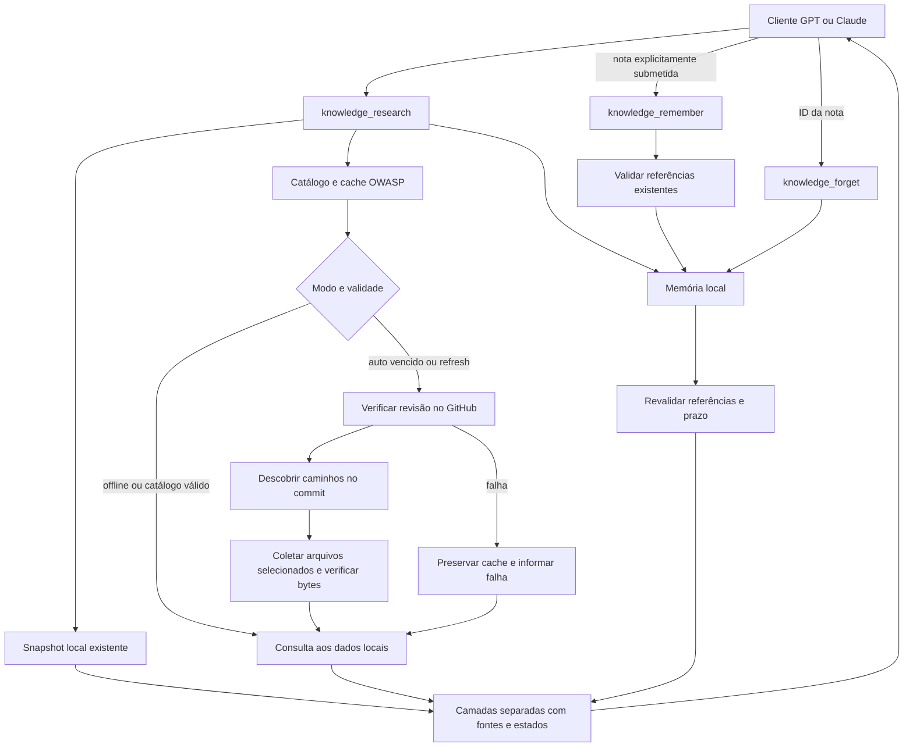

# Pesquisa sob demanda e memória derivada

Revisão de 21/10/2026. Esta extensão aproveita a base existente e acrescenta coleta OWASP sob demanda e memória local. Ela não transforma o GitHub em um índice semântico nem treina o modelo conectado. A validação desta entrega está em [Implementação](IMPLEMENTACAO.md), incluindo testes automatizados e consulta real pelo SDK MCP.

## Fluxo implementado



O snapshot conserva SQLite, entidades, relações, originais, E5 e Qdrant já preparados. O cache usa `data/ondemand/cache.sqlite3`, com versões de documentos e FTS5. As notas usam `data/memory/memory.sqlite3`, também com FTS5. Os três armazenamentos pertencem ao mesmo diretório de dados, mas mantêm finalidades distintas.

`knowledge_research` retorna `layers.snapshot`, `layers.source_cache` e `layers.memory`. Escores das camadas não são comparáveis. Documentos do snapshot também presentes entre os resultados do cache são omitidos da camada do snapshot; uma nota derivada nunca conta como confirmação independente da sua fonte. As ferramentas antigas continuam disponíveis para consultar uma geração reproduzível, inclusive quando o cache contém uma revisão diferente.

## Catálogo e descoberta

`knowledge_catalog` apresenta os cinco repositórios iniciais com assuntos, branch, caminhos, política de verificação e capacidade de consulta. Somente `owasp` usa `on_demand_and_snapshot`; ATT&CK, Sigma, CVE e KEV usam `snapshot_only`. NVD permanece um formato de importação opcional, sem adaptador remoto incluído.

O adaptador OWASP consulta o commit atual da branch `master`, fixa o SHA e lista `cheatsheets/` naquela revisão. A seleção compara nomes de arquivos com termos da pergunta e aliases explícitos em português/inglês. Depois, coleta até três arquivos selecionados e busca lexicalmente seus conteúdos locais. A pergunta não é enviada ao GitHub, e não há um LLM interno para classificar ou resumir o material.

A descoberta por nome pode deixar de encontrar um assunto presente apenas dentro de um arquivo ainda não coletado. `known_paths` mede caminhos conhecidos, enquanto `cached_versions` mede versões realmente preservadas. Nenhum desses valores representa cobertura semântica completa da OWASP.

O parâmetro `path` permite escolher um caminho já catalogado, como `cheatsheets/Password_Storage_Cheat_Sheet.md`. Não aceita URL, saída do diretório, referência de branch escolhida pelo cliente ou arquivo local. Respostas com mil entradas são recusadas por risco de catálogo incompleto, pois a API de conteúdos limita diretórios a mil arquivos. Uma expansão além desse limite precisa de outro mecanismo de descoberta. [API de conteúdos do GitHub](https://docs.github.com/en/rest/repos/contents#get-repository-content).

## Verificação e funcionamento sem rede

| Modo | Comportamento |
| --- | --- |
| `auto` | Reutiliza metadados verificados por até 24 horas; consulta a origem se não há catálogo, se o prazo venceu, se o relógio retrocedeu ou se é preciso recuperar de falha. Pode coletar um arquivo ausente na revisão já conhecida. |
| `refresh` | Solicita nova verificação da branch, mas respeita o intervalo de nova tentativa após falha. Não garante sucesso da rede. |
| `offline` | Não acessa a rede. Busca somente no snapshot, cache já existente e notas elegíveis. |

A verificação do commit usa `ETag` e `If-None-Match` quando disponíveis. Um `304` só é aceito se já existe catálogo compatível; não serve para inventar conteúdo ausente. Requisições condicionais e pausas após limite de API seguem a estratégia documentada pelo GitHub; esta versão acessa apenas recursos públicos e não exige token. [Boas práticas da API](https://docs.github.com/en/rest/using-the-rest-api/best-practices-for-using-the-rest-api#use-conditional-requests).

Cada evidência informa revisão, SHA-256, URL da revisão, referência de licença e `checked_at`. Os estados do cache são `current`, `stale`, `superseded` e `unknown`. `current` significa compatível com a última revisão verificada dentro da política de validade; não significa que houve acesso à origem nesta chamada nem que o conteúdo está factualmente correto.

Falhas de rede, respostas inválidas e limites de API não renovam a verificação. O servidor preserva os bytes anteriores, informa `remote_status`, `last_failure` e `retry_at` e impede tentativas repetidas durante o intervalo. A pausa padrão é de 60 segundos; `403`/`429` sem intervalo utilizável recebem 15 minutos. O `Retry-After` numérico é limitado entre 60 segundos e 24 horas. Isso é contenção local de tentativas, não garantia de liberação pela API ao final do intervalo.

Se uma revisão nova for observada, a anterior deixa de sustentar uma afirmação de atualidade, mesmo que a listagem ou a coleta seguinte falhe. Uma mudança de commit pode invalidar conservadoramente uma referência mesmo quando o arquivo não mudou. A nova revisão precisa ser coletada/verificada antes de sustentar outra nota.

## Recursos e segurança

- Somente URLs geradas para endpoints OWASP aprovados são aceitas. Não são seguidos redirecionamentos, proxies de ambiente, links dos documentos ou URLs de download fornecidas pela resposta. Não há autenticação, cookies ou leitura de credenciais nessa coleta.
- As requisições usam orçamento compartilhado de 20 segundos e timeout de socket de até 5 segundos. Esse orçamento é verificado no fluxo e não constitui promessa de latência exata em qualquer sistema operacional.
- Cada resposta remota tem teto de 1 MiB. O cache limita versões a 1.000 e bytes originais a 128 MiB; o SQLite também tem teto de páginas equivalente a 128 MiB. Índices e metadados podem fazer esse segundo limite ser atingido antes do limite de originais.
- Versões antigas permanecem acessíveis por ID e revisão. Ao atingir a capacidade, novas coletas são recusadas; não existe coleta automática de lixo do cache nesta etapa. Não apague o banco para liberar espaço se precisar preservar as referências das notas.
- Pesquisa aceita pergunta de até 4.000 caracteres e `limit` de 1 a 3 por camada. A memória examina no máximo 50 candidatos lexicais por busca; o serviço limita verificações de referências e volume de bytes, podendo omitir notas quando a verificação não couber.
- A coleta remota tem trava própria. Esperar a rede não ocupa a trava do snapshot; outra operação dessa extensão pode receber `BUSY`. A etapa local da pesquisa ainda compartilha a inferência com as consultas tradicionais.

Fontes e notas são sempre dados não confiáveis. Nenhum conteúdo é executado como shell, SQL, código ou instrução de sistema. As anotações MCP descrevem os efeitos das operações, mas as verificações de entrada e as permissões são aplicadas pelo código. Isso reduz a superfície de abuso sem comprovar resistência completa a prompt injection no cliente conectado.

## Memória explícita e verificável

`knowledge_remember` recebe `text`, `references` e `ttl_days`. Cada referência deve ser copiada de `evidence_reference` retornado pela pesquisa ou leitura do cache:

```json
{
  "store": "cache",
  "document_id": "ID retornado pela ferramenta",
  "revision": "revisão retornada pela ferramenta",
  "original_hash": "SHA256 retornado pela ferramenta"
}
```

Referências com `store: "snapshot"` também exigem `snapshot_id`. Os valores acima são descritivos; não são uma referência válida para executar. Não forneça URLs ou citações livres: o servidor resolve a referência existente, confere os bytes e verifica sua atualidade.

| Regra | Implementação |
| --- | --- |
| Texto | Até 4.000 caracteres; retorno na busca limitado a 1.200 caracteres, com indicação de truncamento. |
| Evidências | De 1 a 8 referências; todas precisam estar verificáveis e atuais para gravação. |
| Confiança | Sempre `derived_unverified`. Referência existente não prova que a conclusão decorre dela. |
| Validade | De 1 a 90 dias; padrão 30. Duplicata exata não prorroga o prazo. |
| Capacidade | Até 1.000 notas e 8 MiB de texto UTF-8. |
| Busca | Lexical, separada das fontes. Filtro de fontes exige que todas as citações da nota pertençam às fontes selecionadas. |
| Mudança de evidência | Referência substituída ou ausente invalida a nota; indisponibilidade ou desatualização temporária suprime seu retorno. |
| Expiração | Pesquisa, gravação e exclusão removem notas expiradas e suas entradas do índice. O catálogo apenas informa `expired_pending`; não limpa notas. |
| Exclusão | `knowledge_forget` remove somente o `memory_id` indicado e seu índice. Originais das fontes permanecem. |

A exclusão utiliza `secure_delete` e reconstrução do índice de notas, mas não elimina cópias em backups, snapshots do sistema de arquivos ou respostas já enviadas ao cliente. Conteúdo sensível e conversas privadas não pertencem a essa memória.

O servidor não recebe automaticamente o histórico da conversa. Um cliente precisa submeter deliberadamente uma nota pela ferramenta de gravação. O crescimento do cache e da memória muda o que pode ser recuperado; não modifica os pesos de GPT, Claude ou E5. Clientes da mesma instalação compartilham a memória quando apontam para o mesmo diretório. Instalações diferentes não trocam notas.

## Contrato e atualização

As cinco consultas originais mantêm seus contratos. As cinco operações novas são:

| Ferramenta | Efeito |
| --- | --- |
| `knowledge_catalog` | Inspeção local do catálogo, cache e contagens da memória. |
| `knowledge_research` | Consulta as três camadas; pode acessar origens aprovadas, gravar cache e limpar notas expiradas. |
| `knowledge_get_cached_document` | Lê versão do cache, com partes de até 9.000 bytes. Use a mesma `revision` e o `next_offset` retornado até `last_part`. |
| `knowledge_remember` | Grava explicitamente uma nota derivada. |
| `knowledge_forget` | Exclui a nota indicada. |

Atualizar o código não troca um núcleo que já está em execução. Reinicie-o e recarregue a conexão MCP do cliente para redescobrir as dez ferramentas. O contrato interno passa a `tool_contract: 2`; um núcleo antigo é identificado por `CORE_UPGRADE_REQUIRED`. Não é necessário reconstruir a base semântica. O [guia de conexão](CONECTAR_CODEX.md) contém os comandos e o roteiro de validação.

## Limites de validação e expansão

Os testes da extensão verificam cache, metadados condicionais, falhas, integridade, paginação, permissões de ferramentas, memória e concorrência. A suíte geral passou com 216 testes e os ajustes posteriores passaram por rodadas focadas. Uma consulta real pelo SDK MCP descobriu dez ferramentas, observou 137 caminhos OWASP e coletou um documento de 20.550 bytes, reconstruído em três páginas com SHA-256 conferido. Reutilização, memória offline e exclusão da nota descartável também passaram. O [relatório sanitizado](../evaluations/results/2026-10-21-ondemand-mcp.json) registra o ensaio.

O benchmark anterior foi repetido: 24 pré-requisitos executáveis aprovados e seis casos pendentes. Ele não comprova 30 respostas aprovadas, nem o comportamento do aplicativo Claude.

Os próximos adaptadores devem aproveitar contratos equivalentes de procedência e falha, respeitando o formato de cada fonte. CVEs podem ser localizados por identificador; ATT&CK e KEV também possuem arquivos agregados que exigem cache por revisão e parsing específico. Ampliar uma lista de URLs, sozinho, não resolve descoberta, indexação, limites de API ou validação factual.
